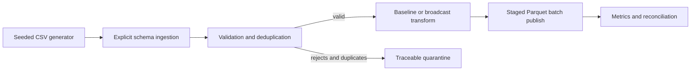

# Architecture

The batch pipeline reads three CSV files, validates transaction keys and references, applies deterministic winner selection, enriches with customer/product dimensions, writes analytical Parquet outputs, and records JSON metrics. Spark performs relational transformations; Python handles configuration and reports.

## Data lineage dashboard metadata

The frontend's lineage graph is a static view derived from the checked-in input schemas, `read_inputs`, `classify`, the baseline and optimized transformation modules, and `publish`. It describes the current code path and does not claim that a selected job completed any particular stage.

The job API persists a job ID, status, timestamps, logs, and batch report references. Run metric reports also contain a `run_id`, mode, timestamps, output record totals, and publication details. The dashboard associates a report with a selected job only when the referenced batch and mode match and the report's start/end timestamps fall within that job's recorded execution window. A batch reference alone is not a unique job-to-run link; existing reports are overwritten per batch/mode.

The checked-in API does not expose per-source record counts, per-output schemas and row counts, stage-level execution status/duration, or a direct job ID in the run manifest. The dashboard leaves those fields unavailable rather than inferring them from aggregate totals. A future backend enhancement can expose a run manifest keyed by job ID with input file metadata, per-output metadata, stage outcomes, and an explicit job/run association; this does not require changing the Spark transformations.

## Reports and exports

The Reports Center builds its catalog from persisted job history, the job report-reference metadata, and the existing run-report and benchmark-report endpoints. Batch reports are associated with a historical job only when the batch ID, mode, and report start/end timestamps match that job's recorded execution window. Missing or overwritten batch reports remain unavailable; the jobs API exposes paginated history but no total count or independent report inventory.

Validation results are parsed from the selected validation job's persisted standard output. They are not separate report files. Benchmark JSON, CSV, and Markdown use fixed filenames; the API exposes parsed/normalized content, but not a per-file generation timestamp or producing job ID. Benchmark CSV and Markdown may therefore be older than a replacement benchmark JSON report, and are not linked to historical benchmark jobs.

There is no report download endpoint. Frontend exports are generated from the content returned by the existing API, so they are snapshots and are not guaranteed to preserve original file bytes or formatting. The smallest future API enhancement for stronger provenance and exact downloads is a report manifest keyed to job/run IDs with per-artifact generation metadata and a constrained download endpoint that preserves the existing report-root allowlist.
